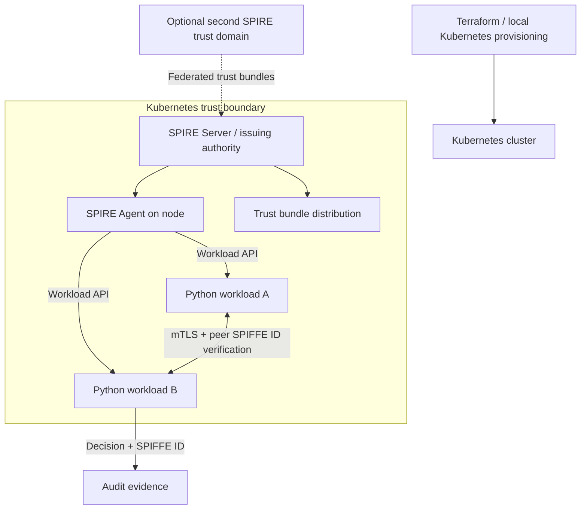

# Cloud-Native Workload Identity & Zero Trust

**Workload identity · SPIFFE / SPIRE · Kubernetes · X.509-SVID · mTLS · trust domain federation**

## Purpose and success criteria

Build a local Kubernetes reference environment where service identity is bound to workload attestation rather than a manually copied static secret. SPIRE issues short-lived X.509-SVID credentials, workloads authenticate each other with mutual TLS, and the receiving service explicitly authorizes SPIFFE IDs. Optionally demonstrate federation across two local trust domains and patterns inspired by evolving WIMSE drafts.

**Acceptance criteria:** two Python services obtain verifiable workload identities; an authorized peer completes mutual TLS; an unregistered/unauthorized workload is rejected; certificate rotation does not require long-lived embedded secrets; a peer from a federated trust domain is authenticated **but not automatically authorized**.

## Logical architecture



**Trust boundaries:** TB1 cluster bootstrap/attestation; TB2 SPIRE server-agent trust; TB3 local workload to Workload API; TB4 inter-service mTLS; TB5 inter-domain bundle federation. Authenticating the remote identity is only the first step: applications must enforce allowlisted SPIFFE IDs, methods and resource permissions.

## Core components

| Component | Responsibility | Key constraint |
|---|---|---|
| Kubernetes (kind or k3d) | Local orchestrator for demo workloads | Minimal RBAC, namespace isolation |
| SPIRE Server | Registration, attestation and SVID issuance | Scoped registration selectors and trust domain |
| SPIRE Agent | Node/workload attestation and Workload API | Secure Workload API socket access |
| Python workload A | Authorized caller | Fetch and refresh SVID via Workload API |
| Python workload B | Receiving API | Validate chain, peer identity and permissions |
| Trust bundles | Roots used to validate peers | Explicit distribution and rotation strategy |
| Terraform local stack | Reproducible provision/destroy | No remote paid state required |
| Evidence collector | Attestation, mTLS and authorization logs | Never log private keys or raw SVID material |

## Functional flows

### F1 - Workload attestation and issuance

1. Provision the cluster and install SPIRE with a pinned Helm chart or manifests.
2. Register the required workload selectors and expected SPIFFE IDs.
3. A workload contacts the local SPIRE Agent through the Workload API.
4. After attestation, it receives a short-lived X.509-SVID and current trust bundle.
5. Log the resulting SPIFFE ID and validity metadata, not the private key.

### F2 - Mutual TLS and resource authorization

1. Workload A connects to B using an application mTLS library or explicitly configured proxy.
2. Both peers validate the certificate chain against appropriate bundles.
3. B extracts A's SPIFFE ID and checks it against a deny-by-default authorization policy.
4. Allowed read access succeeds; an identity with a valid SVID but insufficient permissions receives a denial.

### F3 - Certificate lifecycle

Verify automatic refresh before expiry, trust-bundle rotation handling and behavior when the Workload API or authority is unavailable. Distinguish an existing authenticated session from new handshakes and document the recovery/fail-safe policy. Avoid production claims based only on a short local demonstration.

### F4 - Federation and WIMSE extension

Create an optional second local trust domain, exchange approved trust bundles and test both federated identity acceptance and independent service authorization. Record the exact version and status of any WIMSE Internet-Draft used. Federation should never imply blanket cross-domain access.

## Example identity policy

```yaml
allowed_callers:
  - spiffe_id: spiffe://globalfin.local/ns/finance/sa/report-reader
    methods: [GET]
    paths: [/reports]
  - spiffe_id: spiffe://globalfin.local/ns/finance/sa/analysis-agent
    methods: [POST]
    paths: [/reports/analyze]
```

This is an **illustrative policy contract**, not a built-in SPIRE configuration format. Implement and test the application enforcement layer explicitly.

## Proposed repository structure

```text
cloud-native-workload-identity/
├── README.md
├── Makefile
├── .env.example
├── infrastructure/
│   ├── terraform/
│   ├── kubernetes/{namespaces,rbac,network-policies}/
│   └── spire/{server,agent,registrations}/
├── apps/{workload-a,workload-b}/
├── trust/{bundles,federation}/
├── policies/
├── experiments/{certificate-rotation,federation,wimse-patterns}/
├── tests/{unit,integration,security,rotation}/
├── scripts/{bootstrap,demo,evidence,cleanup}/
├── docs/{architecture,adr,threat-model,controls,runbook}/
├── evidence/
└── .github/workflows/
```

## Test and evidence plan

| Scenario | Expected outcome | Proof |
|---|---|---|
| Attested workload with valid registration | Receives SVID | SPIFFE ID + sanitized issuance event |
| Unknown registration selectors | No authorized identity | Denied issuance/registration |
| Valid peer authorized for endpoint | Success | Handshake + policy allow event |
| Valid identity without route authorization | Denied | SPIFFE ID + policy decision |
| Expired certificate / incorrect trust bundle | Failed handshake | TLS validation error |
| Untrusted or spoofed SPIFFE ID | Rejected | Peer verification failure |
| SVID refresh | New valid certificate | Before/after validity metadata |
| Federated but unauthorized peer | Authenticated, request denied | Separate authn and authz logs |

## Architecture decisions and threat model

**Initial ADRs:** kind versus k3d, SPIRE attestation strategy, trust-domain naming, application-level mTLS versus sidecar, selectors and registration, certificate TTL, trust-bundle distribution, failure handling and optional federation.

**Threats:** malicious pod impersonation, access to the Workload API socket, weak node attestation, compromised host or agent, certificate exfiltration, trust bundle substitution and overly permissive federated access. Document the limitations of local host-based trust and how a production cluster would differ.

**Principal-level comparison:** evaluate Kubernetes Service Account tokens, SPIFFE X.509-SVIDs and OAuth Client Credentials as complementary mechanisms. Cover identity assertion, audience, credential lifetime, cryptographic transport binding, rotation and authorization boundaries.

## Delivery roadmap

1. Provision local Kubernetes with Terraform-managed bootstrap components.
2. Deploy SPIRE Server/Agent and register two workload identities.
3. Implement mTLS between Python services with strict peer allowlisting.
4. Add negative authentication/authorization and rotation tests.
5. Extend to two local trust domains, then publish a WIMSE draft-alignment note.

## References

- [SPIFFE concepts and specifications](https://spiffe.io/docs/latest/spiffe-about/overview/)
- [SPIRE documentation](https://spiffe.io/docs/latest/spire-about/)
- [Kubernetes documentation](https://kubernetes.io/docs/)
- [IETF WIMSE working group](https://datatracker.ietf.org/wg/wimse/about/)

## Enterprise scenario

If a human analyst requests a financial report review; an orchestrator agent delegates narrowly scoped work to a specialist; a protected API and MCP/RAG tools return synthetic records; a governance system captures ownership, approvals, access decisions and security findings. The four projects are individually demonstrable and designed to compose into one reference architecture.

## Security principles

- **Default deny and least privilege:** authenticate identities and authorize every sensitive operation and resource, not merely a successful login.
- **Explicit trust boundaries:** independent checks at identity providers, workload endpoints, gateways, policy engines and audit sinks.
- **Short-lived credentials and constrained delegation:** restrict audience, actions, time, identity and resource whenever supported.
- **Evidence-driven design:** attach a repeatable positive and negative test to every claimed security control.
- **No real financial or personal data:** use synthetic fixtures and local services. Never commit tokens, private keys, kubeconfigs or credentials.
- **Portable infrastructure:** prefer reproducible local Docker/Kubernetes tooling and Terraform Community Edition; require no paid services.

## Engineering workflow (target state)

The repository layout and commands below describe the **planned implementation**; they are not claims that the components have already been built. After implementation, document validated versions and exact prerequisites in `docs/runbook.md`.

1. Install the documented runtime versions and clone the repository.
2. Copy `.env.example` to a local `.env` and populate **development-only** values; do not commit `.env`.
3. Run `make bootstrap` to provision local dependencies, then `make up` for the lab.
4. Run `make test` and `make security-test`; capture deterministic pass/fail evidence in `evidence/`.
5. Run `make demo` for the documented allowed and denied scenarios, and `make down` to clean up.

**Suggested Makefile interface:** `bootstrap`, `up`, `down`, `lint`, `test`, `security-test`, `demo`, `evidence`, `clean`. Implement these targets and avoid adding commands to the README before they actually work.

## Documentation and delivery artifacts

Each repository is expected to contain the following **eight evidence categories**: (1) architecture diagram and trust boundaries, (2) architecture decision records, (3) running source code and local infrastructure, (4) automated unit/integration/security tests, (5) threat model, (6) risk-to-control/test matrix, (7) clearly identified limitations and residual risk, and (8) reproducible demo and logs. Prefer durable Markdown artifacts under `docs/` and redacted sample outputs under `evidence/`.

## CI/CD and repository protection

The planned pipeline should run Markdown and YAML linting, Python formatting/type checks, unit and integration tests, policy tests where applicable, dependency and container scanning, secret scanning, IaC validation and a build smoke test. Pin container image versions, dependencies and CI actions. Use branch protection, pull-request review and least-privileged workflow tokens. Never upload secrets as build artifacts; redact subject identifiers and claims from audit examples.

## Integrating the four repositories

| Repository | Primary contribution |
|---|---|
| `advanced-oauth-delegation` | OAuth/OIDC identities, delegated access tokens and API-side validation |
| `cloud-native-workload-identity` | Cryptographic identities for services and mutually authenticated transport |
| `agentic-ai-security-gateway` | Agent/tool invocation enforcement and fine-grained policy decisions |
| `nhi-governance-itdr` | Ownership, identity lifecycle, risk signals, access reviews and evidence |

Integration is **optional for local standalone demonstrations**. Document API contracts, trust domains and the expected failure mode before enabling cross-project scenarios. Authentication does not imply authorization; trust bundle federation does not imply access permission; an agent's output is never a policy decision.

## Scope and limitations

This is a reference laboratory and portfolio architecture, **not** a production-certified or independently audited security product. Prototypes, custom adapters, experimental provider features and standards still under development must be labeled as such. Production deployments would additionally require resilient key management, HA, telemetry/SIEM integration, formal operational controls, privacy review, disaster recovery and organizational approval.
